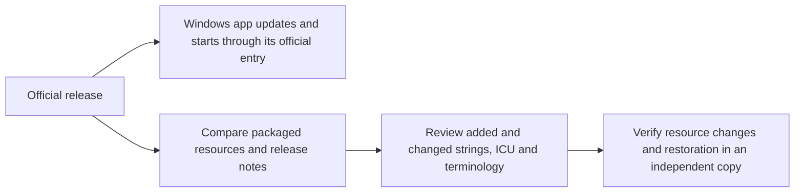

# Claude Chinese Localization Toolkit (claude-chinese)

<p align="center">
  <a href="https://github.com/yiheng8023/claude-chinese/actions/workflows/ci.yml"></a>
  <a href="https://github.com/yiheng8023/claude-chinese/releases/latest"></a>
  <a href="https://github.com/yiheng8023/claude-chinese/releases"></a>
  <a href="https://github.com/yiheng8023/claude-chinese/stargazers"></a>
  <a href="https://github.com/yiheng8023/claude-chinese/network/members"></a>
  
  
  <a href="LICENSE"></a>
</p>

<p align="center">
  <a href="README.md">简体中文</a> | <a href="README.en.md">English</a>
</p>

A recoverable Chinese localization toolkit for Anthropic **Claude Desktop**. The verified Windows client version is **6.6395.0**.

> **Windows 10 / 11 (x64)** users only need the [official Claude Desktop Win32 (Squirrel) installer](https://releases.claude.com/api/desktop/win32/x64/exe/latest/redirect). Then follow the [Windows quick start](#windows) to add the localization.

---

## 🌟 Key Features

- **Native i18n overlays**: generate Chinese catalogs incrementally while keeping official English catalogs as fallback.
- **Reviewed terminology**: distinguish Diff from Change and Branch from Fork; preserve configuration keys, model IDs and protocol names where appropriate.
- **Four catalog layers**: Shell, Ion, dynamic model descriptions and foldable help. Historical translations and terminology are kept for compatibility.
- **Expanded help checks** cover 156 references and 152 distinct bodies. Tests check translations, code and links, and the audit validates original source fingerprints.
- **Resilient locale registration**: recognize the main-process locale-map structure without depending on minified symbol names; fail explicitly if registration cannot be verified.
- **Recoverable installation**: stage and verify both ASARs and the executable, then stage complete files beside each target before replacement; persist recovery records before the first write, verify full hashes after rollback, and retain matching original backups.
- **Update detection**: verify file SHA-256, toolkit version and dictionary digest. Prefer a coherent new official installation over stale backups; reject mixed versions and unknown modifications.
- **Actual validation**: parse ICU messages, nested arguments, format types and select branches while allowing Chinese plural grammar; syntax-check modified renderer and main-process JavaScript.
- **Bounded scope**: no mirror client, Cowork eligibility changes, CC Switch routing changes or replacement updater. Save work and exit a running client before patching.

---

## 🗺️ Project Scope and Structure

This project localizes the client UI through four layers: native Shell menus, Ion/Web UI, dynamic model descriptions and foldable long documents. Third-party inference settings are in scope for translation; routing, credential management and account features remain with the client and existing tools such as CC Switch.

This release supports Windows **6.6395.0**. In-place localization was verified on an installed Squirrel client, with the registered **6.6395.0.0** package used to cross-check the original resources. Existing loose-resource layouts on macOS/Linux remain supported.

---

## 📋 Prerequisites

1. **Supported Operating Systems**:
   - **Windows**: Windows 10 / 11 (x64). Localization supports Squirrel installations, compatible loose layouts, and independent test copies.
   - **macOS**: macOS 12+ (Apple Silicon M-series & Intel chips)
   - **Linux**: Major distributions (Ubuntu, Debian, Fedora, Arch, etc., x64 / ARM64)
2. **Node.js Runtime Environment**:
   - **Node.js (Recommended >= 22.12.0 LTS, Minimum Compatible >= 20.x)** with `npm`.
   - Run `node -v` to verify. If not installed, download the LTS release from [Node.js Official Website](https://nodejs.org/).
   - ⚠️ **Engine Dependency Compatibility Note**:
     - **Recommended Baseline (Zero Warning)**: **Node.js ≥ 22.12.0** (Node 22 LTS or Node 24+). The underlying archive dependency `@electron/asar` declares `engines.node: ">=22.12.0"`, providing a native, zero-warning installation and execution environment.
     - **Compatibility Status**: CI includes **Node.js 20.x**, but dependency installation may emit `EBADENGINE` and may fail with `engine-strict=true`. Passing Node 20 CI does not establish compatibility with every earlier minor version. Prefer Node 22.12+.
3. **Official Claude Desktop installed**. On Windows, use the Win32 (Squirrel) installer above. Its installation root is `%LOCALAPPDATA%\AnthropicClaude`. The general-purpose `ClaudeSetup.exe` and Microsoft Store can deploy MSIX, which this toolkit does not localize in place. Unified Claude combines Chat and Cowork in one interface. Running local Cowork tasks on Windows still requires the virtual machine service in the full installation. [Claude Windows deployment guide](https://support.claude.com/en/articles/12622703-deploy-claude-desktop-for-windows) · [Desktop configuration changelog](https://claude.com/docs/third-party/claude-desktop/configuration-changelog)

---

Patching changes ASAR files and integrity records in the Windows executable, **invalidating the original publisher signature**. Security software or device policy may reject the operation. Electron Fuse 4 stays enabled; the toolkit does not disable protection or create a second client. Tests cover incomplete staging, replacement denial, rollback and process termination after a single file replacement. Multi-file commits are not atomic; an unfinished transaction blocks later writes and retains recovery records. Power loss, termination inside a replacement system call and concurrent external writers are outside the verified automatic rollback guarantee. Retain original backups.

After installing the localization, select Chinese (Simplified) in the target client's language picker.

Install dependencies with `npm ci`; dependency installation no longer patches an installed Claude client. Run `node cli.js install` or `npm run patch` explicitly.

On a Windows test machine, the stock Squirrel updater applied a pre-downloaded and verified 6.6395.0 package over a localized 5.11492.5 installation. The same Win32 shortcut opened the new version. After rerunning `install.bat`, we verified the Chinese UI and observed the client starting its automatic update check.

The 6.6395.0 maintenance pass checked official release notes and packaged resources, including managed policy for local MCP servers, SSH/WSL file downloads and update messages. Compared with 5.11492.5, the upstream Shell added 58 entries and Ion added 2,321. This pass translates 58 Shell entries, 110 Ion messages and 20 third-party inference help bodies, and rebinds 58 context-specific strings to the new modules. Older regression snapshots remain useful for compatibility. Identical English text is reviewed by message ID and component context. [Desktop changelog](https://claude.com/docs/cowork/changelog#v6-6395-0) [Configuration changelog](https://claude.com/docs/third-party/claude-desktop/configuration-changelog#v6-6395-0)

The follow-up adds 266 catalog entries across permission modes, session nesting, general and privacy settings, system storage, MCP status, and third-party inference validation. `npm run audit:ui` checks 62 modules and 4,471 UI messages against their original source fingerprints. Account, model and service-delivered messages depend on the runtime environment. Official feature names such as `Unified Claude` and `Ultracode` are kept in English.

## 🚀 Quick Start

### Method 1: Installation Scripts

#### Windows

1. Download and install the official Win32 edition linked above. The installer may be an earlier build. Open Claude and check for updates from Help. After the update and restart, check the version in About. We verified **6.6395.0**.
2. Save your work and exit Claude completely, then run this project's `install.bat`. If MSIX is also installed, use `install.bat --path "%LOCALAPPDATA%\AnthropicClaude"` to select Win32. To restore English, run `uninstall.bat` with the same `--path` if you specified one.
3. Open Claude from the Start menu or a shortcut. Optionally run `node cli.js shortcut --path "%LOCALAPPDATA%\AnthropicClaude" --output "%USERPROFILE%\Desktop\Claude.lnk" --no-backup` to create a shortcut pointing to the official Squirrel launcher. Run the localization installer again after Claude updates.

#### macOS / Linux
- **Install Patch**: Run `./install.sh` in terminal
- **Restore English**: Run `./uninstall.sh` in terminal

---

### Method 2: CLI Command Line Manager

```bash
# 1. Check current client and patch status
node cli.js status

# 2. Run comprehensive pre-flight health checks (Node version, client paths, file locks, and ACLs)
node cli.js check

# 3. Install the localization (use --path for a side-by-side Windows install or test copy)
node cli.js install

# 4. Optional resource/dictionary watcher (exit the client before patching; restart after ASAR changes)
node cli.js watch

# 5. Launch the client (uses the official entry for the Windows Squirrel build)
node cli.js launch

# 6. Run upstream drift scan
node cli.js drift

# 7. Restore a compatible localization target
node cli.js restore
```

---

## 🧪 Automated Testing & Quality Assurance

The project introduces rigorous end-to-end automated testing, mutation fuzzing, and a cross-platform CI pipeline (Windows / macOS / Ubuntu):

```bash
# Run all core automated test suites (including ASAR rollback, update and restore regressions)
npm test

# Run AST syntax integrity and crash prevention test
npm run test:ast

# Run preflight upstream compatibility matrix and code topology mutation tests
npm run test:matrix

# Run comprehensive localization consistency and ICU terminology audit
npm run audit

# Check npm advisories (fail for moderate or higher severity, or query errors)
npm run audit:deps
```

The current release uses `@electron/asar@4.3.2`, whose upstream dependency ranges now accept the newer glob/minimatch releases; obsolete temporary overrides have been removed. The lockfile resolves `glob@14.0.6` and `minimatch@11.0.8`, covering GHSA-3g3m-2fjr-6pw4, GHSA-g3hv-75wg-m249, GHSA-cf2h-pxjq-68xw and [GHSA-qxr8-q827-836c](https://github.com/isaacs/node-glob/security/advisories/GHSA-qxr8-q827-836c). Packaging enumerates from inside the source directory so braces or brackets in parent paths are not interpreted as globs. Tests cover traversal cancellation, pattern and ignore expansion limits, long-wildcard compilation work, special directory names, archive inventories, hidden files and multiple unpacked paths; macOS/Linux CI covers symbolic links.

Both regular CI and the daily sentinel run `npm run audit:deps`. `npm run audit` remains a localization audit and does not replace dependency security checks. The security check depends on the npm advisory service; query failures also block the check and do not by themselves indicate a new vulnerability.

- **Dictionary Integrity (`test/verify-dict.js`)**: Verifies baseline dictionary syntax, key-value integrity, and format specs (1,368 current Shell baseline keys).
- **ICU Syntax Firewall (`test/test-icu.js`)**: Parse all messages and compare against actual installed English catalogs when available; explicitly mark missing upstream sources as skipped.
- **Lifecycle & Anti-Downgrade Verification (`test/test-restore-cycle.js`)**: Tests isolated install -> status assertion -> double-install idempotence -> pristine restoration, plus dedicated circuit breaker assertions preventing silent upstream update overwrites.
- **Cross-Platform Live Detector (`test/test-cross-platform-live.js`)**: Validates 0-argument system path detection and real sandbox injection/restore across Windows, macOS, and Linux runners.
- **AST Syntax Firewall & Black-Screen Crash Prevention (`test/test-ast-syntax.js`)**: Enforces strict Node.js ESM AST integrity checks across real and sandboxed JS bundles, preventing syntax errors from reaching production.
- **Preflight Compatibility Matrix & Mutation Testing (`tools/upstream-compatibility-matrix.js` / `npm run test:matrix`)**: Simulates extreme bundler minification mutations (variable renaming, arrow functions, Object.assign fallbacks), asserting code topology resilience against available upstream source and synthetic fixtures.
- **Ultimate Localization Consistency Audit (`tools/ultimate-consistency-audit.js` / `npm run audit`)**: Comprehensive audit of thinking efforts, approval workflows, action verbs, Fork vs Branch disambiguation, Diff vs Change isolation, and native state machine enum integrity (8 dedicated suites), reporting detected HTML, ICU and terminology discrepancies with failing exit codes.

---

For a localized Windows installation or test copy, run `npm run verify:client -- "<installation root>"` to check the archives, executable integrity, original backups, English catalog bytes and fuse state.

## 🔄 Self-Evolving Pipeline



---

## 📁 Repository Structure

```text
claude-chinese/
├── .github/
│   └── workflows/
│       ├── ci.yml                    # Cross-platform (Windows/macOS/Linux) CI test pipeline
│       └── upstream-matrix-sentinel.yml # Preflight compatibility & mutation fuzzing daily sentinel
├── dict/                             # Core Chinese dictionaries
│   ├── zh-CN.json                    # Shell layer translation dictionary
│   ├── ion-zh-CN.json                # Web/Ion core UI dictionary
│   ├── long-docs-zh-CN.json          # Full foldable deep documentation guides
│   ├── dynamic-zh-CN.json            # Dynamic features & reasoning placeholders dictionary
│   └── scoped-ui-zh-CN.json          # Module- and source-context-limited UI text patches
├── core/                             # Core injection & architecture engine
│   ├── patcher.js                    # Multi-signature long docs engine, JS whitelist & baseline healing
│   ├── msix-detector.js              # MSIX container detector & cross-platform layout resolver
│   ├── permissions.js                # Windows ACL security permissions and elevation utility
│   └── preflight.js                  # Comprehensive environment health checker (Node/Client/Locks)
├── test/                             # Automated regression test suites
│   ├── verify-dict.js                # Dictionary syntax and integrity assertions
│   ├── test-icu.js                   # 31,000+ entries ICU placeholder and terminology protection
│   ├── test-restore-cycle.js         # Install/restore lifecycle & silent update anti-downgrade assertions
│   ├── test-cross-platform-live.js   # 0-argument path detection & sandbox injection tests
│   ├── test-ast-syntax.js            # AST syntax integrity and crash prevention assertions
│   └── test-ui-coverage.js           # Message coverage, source drift, retained text and rich-text regressions
├── tools/                            # Automation engineering and compatibility toolchains
│   ├── upstream-compatibility-matrix.js # Preflight multi-version compatibility matrix & mutation fuzzer
│   ├── drift-detector.js             # Upstream text diff extraction & drift detector (scan:drift)
│   ├── comprehensive-audit.js        # Full-dimension localization quality & technical enum audit (audit)
│   ├── ultimate-consistency-audit.js # Global terminology, ICU variables & HTML symmetry deep audit
│   ├── audit-ui-coverage.js          # Reviewed UI module coverage against original client sources
│   └── compile-zh-dict.js            # Baseline incremental merge & dictionary compilation tool
├── docs/assets/sponsoring/           # Sponsorship & community assets
├── cli.js                            # Cross-platform CLI lifecycle entry point
├── install.bat / install.sh          # One-click installation scripts
├── launch.bat                        # Self-healing launcher script
├── uninstall.bat / uninstall.sh      # One-click restore scripts
├── package.json                      # Project configuration & npm scripts
├── LICENSE                           # MIT License
└── README.md / README.en.md          # Bilingual documentation
```

---

## 💖 Voluntary Sponsoring & Support

If the Claude Chinese Localization Toolkit has benefited your work and daily development, and you would like to support ongoing maintenance, documentation improvements, automated testing, and version updates, voluntary donations of any amount are deeply appreciated. Sponsorship is entirely voluntary and does not constitute any service-level agreement.

- **RMB Sponsorship**: Scan the WeChat Pay or Alipay QR codes below.
- **Cross-Border / Other Currencies**: Use our **[PayPal Sponsoring Link](https://www.paypal.com/ncp/payment/LNTF8KXGJXMZY)**. Accepted currencies, payment methods, and exchange rates are subject to PayPal's checkout page.

Please verify the payee name shown on the checkout page before confirming payment. Thank you for your support of open-source software!

<table>
  <tr>
    <td align="center"><strong>WeChat Pay (RMB)</strong><br></td>
    <td align="center"><strong>Alipay (RMB)</strong><br></td>
  </tr>
</table>

---

## 👥 Contributors

Heartfelt thanks to all developers who contribute code, report bugs, and improve translations and documentation!

<p align="center">
  <a href="https://github.com/yiheng8023/claude-chinese/graphs/contributors">
    
  </a>
</p>

---

## 📈 Star History & Community Growth

[](https://star-history.com/#yiheng8023/claude-chinese&Date)

---

## ⚠️ Disclaimer & Compliance

1. **Non-Official Project**: This project is an independent open-source localization utility developed by the open-source community. It is **NOT** an official product of Anthropic, PBC and is neither affiliated with nor endorsed by Anthropic, PBC or its subsidiaries.
2. **Trademark Notice**: `Claude`, `Anthropic`, `DeepSeek`, and related trademarks, product names, and copyrights are the property of their respective owners.
3. **Authorized Personal Use**: This toolkit is provided solely for personal learning, technical research, and Chinese localization assistance. This project **DOES NOT** distribute any proprietary binary assets; all patching operations are executed locally on the user's client machine.
4. **Security & Privacy**: This project contains **ZERO** telemetry reporting, network backdoors, or credential extraction mechanisms. All source code is 100% transparent and auditable.

---

## 📄 License

This project is licensed under the [MIT License](LICENSE).
