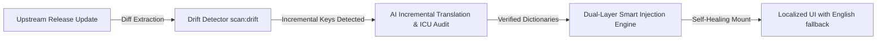

# Claude Chinese Localization Toolkit (claude-chinese)

<p align="center">
  <a href="https://github.com/yiheng8023/claude-chinese/actions/workflows/ci.yml"></a>
  <a href="https://github.com/yiheng8023/claude-chinese/releases/latest"></a>
  <a href="https://github.com/yiheng8023/claude-chinese/releases"></a>
  <a href="https://github.com/yiheng8023/claude-chinese/stargazers"></a>
  <a href="https://github.com/yiheng8023/claude-chinese/network/members"></a>
  
  
  <a href="LICENSE"></a>
</p>

<p align="center">
  <a href="README.md">简体中文</a> | <a href="README.en.md">English</a>
</p>

A recoverable Chinese localization toolkit for Anthropic **Claude Desktop**, code version **v1.2.92**, targeting **4.4212.0** in this update. It maintains incremental native i18n overlays and preserves reviewed translations and terminology.

---

## 🌟 Key Features

- **Native i18n overlays**: generate Chinese catalogs incrementally while keeping official English catalogs as fallback.
- **Reviewed terminology**: distinguish Diff from Change and Branch from Fork; preserve configuration keys, model IDs and protocol names where appropriate.
- **Four catalog layers**: 1,282 Shell entries (961 current English baseline entries), 31,162 Web UI entries, 51 dynamic entries and 286 long documents. Counts include historical compatibility entries and intentionally retained English, not a current-screen translation percentage.
- **Expanded help checks**: this update reviews 126 help references covering 124 distinct bodies in 4.4212, adding 112 missing bodies. Regression checks exercise rendered prose, code examples and links. `npm run audit` also compares the installed client's original documentation modules with the reviewed snapshot and requires a fresh review when their source changes.
- **Resilient locale registration**: recognize the main-process locale-map structure without depending on minified symbol names; fail explicitly if registration cannot be verified.
- **Recoverable installation**: stage and verify both ASARs and the executable before replacing installed files; roll back ordinary write failures and retain matching original backups.
- **Update detection**: verify file SHA-256, toolkit version and dictionary digest. Prefer a coherent new official installation over stale backups; reject mixed versions and unknown modifications.
- **Actual validation**: parse ICU messages, nested arguments, format types and select branches while allowing Chinese plural grammar; syntax-check modified renderer and main-process JavaScript.
- **Bounded scope**: no mirror client, Cowork eligibility changes, CC Switch routing changes or replacement updater. Save work and exit a running client before patching.

---

## 🗺️ Project Scope and Structure

This project localizes the client UI through four layers: native Shell menus, Ion/Web UI, dynamic model descriptions and foldable long documents. Third-party inference settings are in scope for translation; routing, credential management and account features remain with the client and existing tools such as CC Switch.

This update targets Windows **4.4212.0** installed through the official website installer (system package **4.4212.0.0**). Existing loose-resource layouts on macOS/Linux remain supported; synchronization of dual ASAR archives and executable integrity is currently implemented and verified only for the Windows layout.

---

## 📋 Prerequisites

1. **Supported Operating Systems**:
   - **Windows**: Windows 10 / 11 (x64) (Supports the official website installer; Microsoft Store distribution is not supported)
   - **macOS**: macOS 12+ (Apple Silicon M-series & Intel chips)
   - **Linux**: Major distributions (Ubuntu, Debian, Fedora, Arch, etc., x64 / ARM64)
2. **Node.js Runtime Environment**:
   - **Node.js (Recommended >= 22.12.0 LTS, Minimum Compatible >= 20.x)** with `npm`.
   - Run `node -v` to verify. If not installed, download the LTS release from [Node.js Official Website](https://nodejs.org/).
   - ⚠️ **Engine Dependency Compatibility Note**:
     - **Recommended Baseline (Zero Warning)**: **Node.js ≥ 22.12.0** (Node 22 LTS or Node 24+). The underlying archive dependency `@electron/asar` declares `engines.node: ">=22.12.0"`, providing a native, zero-warning installation and execution environment.
     - **Compatibility Status**: CI includes **Node.js 20.x**, but dependency installation may emit `EBADENGINE` and may fail with `engine-strict=true`. Passing Node 20 CI does not establish compatibility with every earlier minor version. Prefer Node 22.12+.
3. **Claude Desktop Installed**:
   - Ensure the official Claude Desktop client is installed on your system.
   - ⚠️ **Windows Distribution Channel Compatibility**:
     - **Supported**: The `.exe` installer downloaded from the [official website](https://claude.com/download). **This installer can deploy an MSIX package into WindowsApps**; the extension and installation directory alone do not identify the distribution channel.
     - **Unsupported**: MSIX / AppX package distributed via the **Microsoft Store**. The detector distinguishes the website package `Claude` from the Store package `AnthropicPBC.Claude` and refuses writes to the latter.

---

Patching changes ASAR files and integrity records in the Windows executable, **invalidating the original publisher signature**. Security software or device policy may reject the operation. Electron Fuse 4 stays enabled; the toolkit does not disable protection or create a second client. Rollback tests cover ordinary write errors, not power loss or concurrent external writers. Retain original backups.

If English remains after restart, select Chinese (Simplified) in the client’s language picker; existing language preferences are preserved.

Install dependencies with `npm ci`; dependency installation no longer patches an installed Claude client. Run `node cli.js install` or `npm run patch` explicitly.

On the website-distributed **4.4212.0** build, Help → Check for Updates returned “You are running the latest version.” The earlier Squirrel error was not reproduced on this build. The toolkit keeps the official updater; if an update replaces localization, exit the client and rerun the launcher or installer.

## 🚀 Quick Start

### Method 1: One-Click Scripts (Recommended for Daily Use)

#### Windows
- **Install Patch**: Right-click and run [`install.bat`](install.bat) as Administrator
- **Self-Healing Launch**: Double-click [`launch.bat`](launch.bat) (Auto-detects upstream updates, re-patches, and launches)
- **Restore English**: Double-click [`uninstall.bat`](uninstall.bat)

#### macOS / Linux
- **Install Patch**: Run `./install.sh` in terminal
- **Restore English**: Run `./uninstall.sh` in terminal

---

### Method 2: CLI Command Line Manager

```bash
# 1. Check current client and patch status
node cli.js status

# 2. Run comprehensive pre-flight health checks (Node version, client paths, file locks, and ACLs)
node cli.js check

# 3. One-click install (runs pre-flight, safely releases file locks, and mounts overlay)
node cli.js install

# 4. Optional resource/dictionary watcher (exit the client before patching; restart after ASAR changes)
node cli.js watch

# 5. Self-healing launch (auto-detects version updates, repairs overlay if needed, and launches)
node cli.js launch

# 6. Run upstream drift scan
node cli.js drift

# 7. One-click restore to official English version
node cli.js restore
```

---

## 🧪 Automated Testing & Quality Assurance

The project introduces rigorous end-to-end automated testing, mutation fuzzing, and a cross-platform CI pipeline (Windows / macOS / Ubuntu):

```bash
# Run all core automated test suites (including ASAR rollback, update and restore regressions)
npm test

# Run AST syntax integrity and crash prevention test
npm run test:ast

# Run preflight upstream compatibility matrix and code topology mutation tests
npm run test:matrix

# Run comprehensive localization consistency and ICU terminology audit
npm run audit
```

- **Dictionary Integrity (`test/verify-dict.js`)**: Verifies baseline dictionary syntax, key-value integrity, and format specs (961 current Shell baseline keys).
- **ICU Syntax Firewall (`test/test-icu.js`)**: Parse all messages and compare against actual installed English catalogs when available; explicitly mark missing upstream sources as skipped.
- **Lifecycle & Anti-Downgrade Verification (`test/test-restore-cycle.js`)**: Tests isolated install -> status assertion -> double-install idempotence -> pristine restoration, plus dedicated circuit breaker assertions preventing silent upstream update overwrites.
- **Cross-Platform Live Detector (`test/test-cross-platform-live.js`)**: Validates 0-argument system path detection and real sandbox injection/restore across Windows, macOS, and Linux runners.
- **AST Syntax Firewall & Black-Screen Crash Prevention (`test/test-ast-syntax.js`)**: Enforces strict Node.js ESM AST integrity checks across real and sandboxed JS bundles, preventing syntax errors from reaching production.
- **Preflight Compatibility Matrix & Mutation Testing (`tools/upstream-compatibility-matrix.js` / `npm run test:matrix`)**: Simulates extreme bundler minification mutations (variable renaming, arrow functions, Object.assign fallbacks), asserting code topology resilience against available upstream source and synthetic fixtures.
- **Ultimate Localization Consistency Audit (`tools/ultimate-consistency-audit.js` / `npm run audit`)**: Comprehensive audit of thinking efforts, approval workflows, action verbs, Fork vs Branch disambiguation, Diff vs Change isolation, and native state machine enum integrity (8 dedicated suites), reporting detected HTML, ICU and terminology discrepancies with failing exit codes.

---

After installation, `npm run verify:client` performs read-only checks of actual archives, executable integrity, original backups, English catalog bytes and fuse state. It does not replace UI verification.

## 🔄 Self-Evolving Pipeline



---

## 📁 Repository Structure

```text
claude-chinese/
├── .github/
│   └── workflows/
│       ├── ci.yml                    # Cross-platform (Windows/macOS/Linux) CI test pipeline
│       └── upstream-matrix-sentinel.yml # Preflight compatibility & mutation fuzzing daily sentinel
├── dict/                             # Core Chinese dictionaries
│   ├── zh-CN.json                    # Shell layer translation dictionary (1,282 entries)
│   ├── ion-zh-CN.json                # Web/Ion core UI dictionary (31,162 entries)
│   ├── long-docs-zh-CN.json          # Full foldable deep documentation guides (286 documents)
│   └── dynamic-zh-CN.json            # Dynamic features & reasoning placeholders dictionary
├── core/                             # Core injection & architecture engine
│   ├── patcher.js                    # Multi-signature long docs engine, JS whitelist & baseline healing
│   ├── msix-detector.js              # MSIX container detector & cross-platform layout resolver
│   ├── permissions.js                # Windows ACL security permissions and elevation utility
│   └── preflight.js                  # Comprehensive environment health checker (Node/Client/Locks)
├── test/                             # Automated regression test suites
│   ├── verify-dict.js                # Dictionary syntax and integrity assertions
│   ├── test-icu.js                   # 31,000+ entries ICU placeholder and terminology protection
│   ├── test-restore-cycle.js         # Install/restore lifecycle & silent update anti-downgrade assertions
│   ├── test-cross-platform-live.js   # 0-argument path detection & sandbox injection tests
│   └── test-ast-syntax.js            # AST syntax integrity and crash prevention assertions
├── tools/                            # Automation engineering and compatibility toolchains
│   ├── upstream-compatibility-matrix.js # Preflight multi-version compatibility matrix & mutation fuzzer
│   ├── drift-detector.js             # Upstream text diff extraction & drift detector (scan:drift)
│   ├── comprehensive-audit.js        # Full-dimension localization quality & technical enum audit (audit)
│   ├── ultimate-consistency-audit.js # Global terminology, ICU variables & HTML symmetry deep audit
│   └── compile-zh-dict.js            # Baseline incremental merge & dictionary compilation tool
├── docs/assets/sponsoring/           # Sponsorship & community assets
├── cli.js                            # Cross-platform CLI lifecycle entry point
├── install.bat / install.sh          # One-click installation scripts
├── launch.bat                        # Self-healing launcher script
├── uninstall.bat / uninstall.sh      # One-click restore scripts
├── package.json                      # Project configuration & npm scripts
├── LICENSE                           # MIT License
└── README.md / README.en.md          # Bilingual documentation
```

---

## 💖 Voluntary Sponsoring & Support

If the Claude Chinese Localization Toolkit has benefited your work and daily development, and you would like to support ongoing maintenance, documentation improvements, automated testing, and version updates, voluntary donations of any amount are deeply appreciated. Sponsorship is entirely voluntary and does not constitute any service-level agreement.

- **RMB Sponsorship**: Scan the WeChat Pay or Alipay QR codes below.
- **Cross-Border / Other Currencies**: Use our **[PayPal Sponsoring Link](https://www.paypal.com/ncp/payment/LNTF8KXGJXMZY)**. Accepted currencies, payment methods, and exchange rates are subject to PayPal's checkout page.

Please verify the payee name shown on the checkout page before confirming payment. Thank you for your support of open-source software!

<table>
  <tr>
    <td align="center"><strong>WeChat Pay (RMB)</strong><br></td>
    <td align="center"><strong>Alipay (RMB)</strong><br></td>
  </tr>
</table>

---

## 👥 Contributors

Heartfelt thanks to all developers who contribute code, report bugs, and improve translations and documentation!

<p align="center">
  <a href="https://github.com/yiheng8023/claude-chinese/graphs/contributors">
    
  </a>
</p>

---

## 📈 Star History & Community Growth

[](https://star-history.com/#yiheng8023/claude-chinese&Date)

---

## ⚠️ Disclaimer & Compliance

1. **Non-Official Project**: This project is an independent open-source localization utility developed by the open-source community. It is **NOT** an official product of Anthropic, PBC and is neither affiliated with nor endorsed by Anthropic, PBC or its subsidiaries.
2. **Trademark Notice**: `Claude`, `Anthropic`, `DeepSeek`, and related trademarks, product names, and copyrights are the property of their respective owners.
3. **Authorized Personal Use**: This toolkit is provided solely for personal learning, technical research, and Chinese localization assistance. This project **DOES NOT** distribute any proprietary binary assets; all patching operations are executed locally on the user's client machine.
4. **Security & Privacy**: This project contains **ZERO** telemetry reporting, network backdoors, or credential extraction mechanisms. All source code is 100% transparent and auditable.

---

## 📄 License

This project is licensed under the [MIT License](LICENSE).
