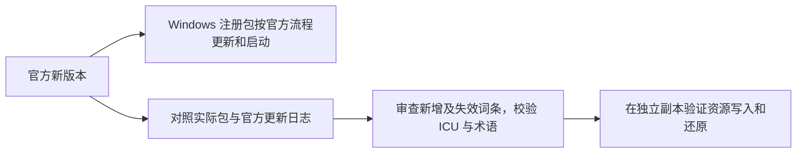

# Claude 桌面端中文汉化工具包 (Claude Chinese Toolkit)

<p align="center">
  <a href="https://github.com/yiheng8023/claude-chinese/actions/workflows/ci.yml"></a>
  <a href="https://github.com/yiheng8023/claude-chinese/releases/latest"></a>
  <a href="https://github.com/yiheng8023/claude-chinese/releases"></a>
  <a href="https://github.com/yiheng8023/claude-chinese/stargazers"></a>
  <a href="https://github.com/yiheng8023/claude-chinese/network/members"></a>
  
  
  <a href="LICENSE"></a>
</p>

<p align="center">
  <a href="README.md">简体中文</a> | <a href="README.en.md">English</a>
</p>


用于 Anthropic **Claude Desktop** 的可恢复中文汉化工具包。Windows 实机适配版本为 **6.6395.0**。

> **Windows 10 / 11（x64）** 只需安装 [Claude Desktop Win32（Squirrel）官方版](https://releases.claude.com/api/desktop/win32/x64/exe/latest/redirect)，然后按 [Windows 快速开始](#windows) 安装汉化。

---

## 🌟 核心特性

- **沿用原生 i18n**：增量生成中文资源，保留官方英文作为回退。
- **保留术语规则**：区分 Diff（差异）与 Change（变更）、Branch（分支）与 Fork（分叉）。配置键、模型 ID、协议名等按上下文保留英文。
- **四层词库**：Shell、Ion、动态模型说明与折叠长文档，保留历史兼容译文和上下文术语规则。
- **折叠正文检查**覆盖 156 处“了解更多”引用和 152 篇不同正文。测试校验译文、代码和链接，审计核对原始源码指纹。
- **新版语言注册**：按语言映射结构匹配主进程，不依赖每次构建变化的混淆变量名；未命中时报告失败。
- **可恢复安装**：在临时目录完成双 ASAR 与主程序的准备和校验，再在目标同目录准备完整文件并替换；正式修改前保存恢复记录，回滚后核验完整哈希，保留同版本原版备份。
- **更新识别**：核对文件 SHA-256、工具版本和词库摘要。官方更新后的新文件优先，拒绝混合版本或不明修改，避免旧备份回退新版。
- **实际检查**：使用 ICU 解析器检查语法、嵌套变量、格式类型与 select 分支；允许符合中文规则的复数写法。修改过的前端及主进程 JS 均执行语法检查。
- **运行边界**：不会自动创建镜像客户端，不改动 Cowork 安装资格、CC Switch 路由或官方更新机制；运行中的客户端需要先保存工作并退出。

---

## 🗺️ 项目范围与结构

本项目专注客户端界面汉化。四层资源分别是 Shell 原生菜单、Ion/Web UI、动态模型说明与折叠长文档。第三方推理配置页面属于汉化范围；模型路由、凭据管理和账号功能继续由客户端及 CC Switch 等原有工具负责。

本轮适配 Windows **6.6395.0**，已在官网 Squirrel 版实机验证原界面汉化。官网注册包 **6.6395.0.0** 用于原版资源核对。macOS/Linux 沿用既有散装资源布局。

---

## 📋 前置环境与要求 (Prerequisites)

1. **操作系统支持**：
   - **Windows**：Windows 10 / 11 (x64)。汉化支持 Squirrel 安装、兼容的散装布局和独立测试副本。
   - **macOS**：macOS 12+（Apple Silicon M 系列及 Intel 芯片）
   - **Linux**：主流发行版（x64 / ARM64）
2. **Node.js 基础运行环境**：
   - 系统中需安装 **Node.js (推荐 >= 22.12.0 LTS，最低兼容 >= 20.x)** 及附带的 **npm**。
   - 验证方式：在终端运行 `node -v`。若未安装，请前往 [Node.js 官方网站](https://nodejs.org/) 下载安装 LTS 版本。
   - ⚠️ **引擎依赖兼容性声明 (Compatibility Note)**：
     - **推荐基线（零警告原生支持）**：**Node.js ≥ 22.12.0**（如 Node 22 LTS 或 Node 24+）。项目底层核心打包依赖 `@electron/asar` 声明 `engines.node: ">=22.12.0"`，在 Node 22+ 下可获得零引擎警告（`EBADENGINE`）的最佳体验；
     - **兼容状态说明**：CI 包含 **Node.js 20.x**，但安装依赖时可能提示 `EBADENGINE`；启用 `engine-strict=true` 时可能阻断安装。Node 20 的 CI 结果不代表所有较早小版本均兼容，建议优先使用 Node 22.12+。
3. **已安装官方 Claude Desktop**。Windows 请使用上方的 Win32（Squirrel）安装器，安装根目录为 `%LOCALAPPDATA%\AnthropicClaude`。官网通用 `ClaudeSetup.exe` 和微软商店可部署 MSIX，MSIX 不支持本项目的原位汉化。`Unified Claude` 将 Chat 和 Cowork 合并到同一界面。Windows 上需要虚拟机服务的功能依照 Anthropic 的部署要求。[Claude Windows 部署说明](https://support.claude.com/en/articles/12622703-deploy-claude-desktop-for-windows) · [桌面配置更新日志](https://claude.com/docs/third-party/claude-desktop/configuration-changelog)

---

补丁会修改 ASAR 及 Windows 主程序内的完整性记录，**原发布者数字签名会因此失效**，安全软件或设备策略可能拒绝此操作。本项目保留 Electron Fuse 4，不关闭系统防护；无法写入时不创建第二个客户端。已覆盖临时写入失败、替换被拒、回滚及单文件替换后的进程中止测试。多个文件并非原子提交；发现未完成事务时会停止后续修改并保留恢复记录。断电、替换系统调用中止或外部进程同时写入不属于已验证的自动回滚保证。请保留原版备份。

安装汉化后，可在目标客户端的语言选择中选“中文（简体）”。

安装依赖使用 `npm ci`，此步骤不再自动修改已安装的 Claude；汉化请显式运行 `node cli.js install` 或 `npm run patch`。

实机在 5.11492.5 已汉化的情况下，用原版 Squirrel 更新程序应用预先下载并校验的 6.6395.0 官方包。同一个 Win32 快捷方式成功启动新版。再次运行 `install.bat` 后，已核对实际中文界面，并观察到客户端发起官方自动更新检查。

另在 Windows x64 的 Win32 6.6395.0 上，使用 CC Switch 配置的第三方推理，通过统一 Claude 入口启动 Cowork 任务。客户端记录了任务成功结束，生成的 CSV 文件也通过逐行校验。这个结果适用于上述测试环境和文件生成任务。

维护核对了 6.6395.0 的官方日志与实际资源，包含本地 MCP 的托管策略、SSH/WSL 文件下载和更新提示。对比 5.11492.5，官方 Shell 新增 58 项，Ion 新增 2,321 项。本轮补译 58 项 Shell、110 项 Ion 文案及 20 篇第三方推理折叠说明，并为新版模块重新绑定 58 处限定文案。旧版回归快照仍有兼容用途。相同英文按词条 ID 和组件上下文分别审查。[桌面端更新日志](https://claude.com/docs/cowork/changelog#v6-6395-0) [配置更新日志](https://claude.com/docs/third-party/claude-desktop/configuration-changelog#v6-6395-0)

后续新增 266 个界面词条，涉及权限模式、会话层级菜单、常规与隐私设置、系统存储、MCP 状态和第三方推理配置校验。`npm run audit:ui` 核查 62 个模块、4,471 条界面消息及原始源码指纹。账号、模型与服务端下发文案取决于运行环境。`Unified Claude` 和 `Ultracode` 等官方功能名保留英文。

## 🚀 快速开始

### 方式一：安装脚本

#### Windows

1. 下载并安装上方链接中的官方 Win32 版。安装器可能是较早的版本。启动 Claude 后从“帮助”检查更新，待更新并重启后，从“关于”确认版本。本轮已验证 **6.6395.0**。
2. 保存工作并完全退出 Claude，再运行本项目的 `install.bat`。如果还装着 MSIX，可用 `install.bat --path "%LOCALAPPDATA%\AnthropicClaude"` 显式选择 Win32。恢复英文时运行 `uninstall.bat`，如使用了 `--path`，请传入相同路径。
3. 平时通过开始菜单或快捷方式启动。可选命令 `node cli.js shortcut --path "%LOCALAPPDATA%\AnthropicClaude" --output "%USERPROFILE%\Desktop\Claude.lnk" --no-backup` 会创建一个指向 Squirrel 官方启动入口的快捷方式。Claude 更新后，重新运行汉化安装脚本即可。

#### macOS / Linux
* **一键安装**：在终端运行 `./install.sh`
* **恢复英文**：在终端运行 `./uninstall.sh`

---

### 方式二：CLI 命令行管理器

```bash
# 1. 查看当前客户端及汉化状态
node cli.js status

# 2. 执行前置环境全维健康预检 (Node 弹性版本、客户端安装、进程锁定与权限)
node cli.js check

# 3. 安装汉化（Windows 并装或使用独立副本时加 --path）
node cli.js install

# 4. 可选：监听资源与词库变化（运行中不强制退出客户端；ASAR 更新后需重启）
node cli.js watch

# 5. 启动客户端（Windows Squirrel 版通过官方入口启动）
node cli.js launch

# 6. 执行上游版本文本漂移分析 (Drift Detection)
node cli.js drift

# 7. 还原兼容的汉化目标
node cli.js restore
```

---

## 🧪 自动化测试与质量保证 (Testing & Verification)

本项目引入严格的端到端自动化测试与跨平台 CI 流水线（Windows / macOS / Ubuntu），避免人工经验验证带来的遗漏：

```bash
# 运行全套自动化测试套件（含完整 ASAR 生命周期与失败回滚回归）
npm test

# 运行 AST 语法完整性与黑屏崩溃拦截专项测试
npm run test:ast

# 运行事前上游兼容矩阵与代码拓扑变异测试
npm run test:matrix

# 运行全维度本地化一致性与 ICU 专有名词审计
npm run audit

# 检查 npm 依赖安全公告（中危及以上或查询失败时返回非零）
npm run audit:deps
```

当前使用 `@electron/asar@4.3.2`；上游已放宽到新版 glob/minimatch 依赖，旧临时 overrides 已移除。锁文件固定 `glob@14.0.6`、`minimatch@11.0.8`，覆盖 GHSA-3g3m-2fjr-6pw4、GHSA-g3hv-75wg-m249、GHSA-cf2h-pxjq-68xw 及 [GHSA-qxr8-q827-836c](https://github.com/isaacs/node-glob/security/advisories/GHSA-qxr8-q827-836c)。打包从源目录内枚举，避免上级目录中的花括号或方括号被解释为 glob。`npm test` 覆盖取消遍历、模式及 ignore 展开上限、长通配符编译工作量、特殊目录名、归档清单/隐藏文件/多条 unpacked 路径；符号链接回归由 macOS/Linux CI 覆盖。

常规 CI 和每日巡检均执行 `npm run audit:deps`。`npm run audit` 仍是本地化内容审计，不代替依赖安全检查。安全审计依赖 npm 公告服务，服务查询失败也会阻断检查，不代表发现了新漏洞。

- **核心字典完整性 (`test/verify-dict.js`)**：验证基础字典结构无缺失、无空值（1,310 项当前外壳基线）。
- **ICU 语法防火墙 (`test/test-icu.js`)**：检查消息语法，并在可读取宿主时对照真实英文校验变量和分支。未安装宿主时明确标记跳过英文对照。
- **生命周期还原闭环 (`test/test-restore-cycle.js`)**：验证真实安装 -> 状态判定 -> 双重安装幂等 -> 干净还原 -> 原版回退全流程，包含官方静默升级防版本回退专项断言。
- **跨平台宿主无参探测与沙盒实测 (`test/test-cross-platform-live.js`)**：在真实 Ubuntu / macOS / Windows runner 上验证 0 参数路径探测与跨平台布局注入。
- **AST 语法防火墙与黑屏拦截 (`test/test-ast-syntax.js`)**：本机有安装时读取当前全部前端 JS，并检查所有被修改文件；CI 无宿主时使用合成样本。语法通过不替代实际启动验证。
- **事前兼容矩阵与代码拓扑变异测试 (`tools/upstream-compatibility-matrix.js` / `npm run test:matrix`)**：模拟打包混淆变异（变量置换、箭头函数、Object.assign 降级），在代码发布前完成代码拓扑韧性压力断言。
- **全维度本地化一致性审计 (`tools/ultimate-consistency-audit.js` / `npm run audit`)**：全面体检思考强度、审批工作流、动作动词、Fork(分叉)与Branch(分支)隔离、Diff(差异)与Change(变更)隔离、以及原生状态机动作词与状态枚举完整性（8 大专项体检），确保 0 HTML 标签不对称、0 ICU 变量偏差与 0 术语冲突。

---

对已应用汉化的 Windows 安装或独立副本，运行 `npm run verify:client -- "<安装根目录>"` 可核对 ASAR、主程序、备份、英文原始字节和熔丝状态。

## 🔄 自动化演进闭环 (Self-Evolving Pipeline)



---

## 📁 仓库结构 (Repository Structure)

```text
claude-chinese/
├── .github/
│   └── workflows/
│       ├── ci.yml                    # 全平台 (Windows/macOS/Linux) CI 自动化测试流水线
│       └── upstream-matrix-sentinel.yml # 上游事前兼容矩阵与混淆变异碰撞每日巡检哨兵
├── dict/                             # 核心汉化词库
│   ├── zh-CN.json                    # Shell 壳层汉化词典
│   ├── ion-zh-CN.json                # Web/Ion 核心 UI 词典
│   ├── long-docs-zh-CN.json          # 全景折叠长文档与企业级深度说明词典
│   ├── dynamic-zh-CN.json            # 动态特性与推理占位符词典
│   └── scoped-ui-zh-CN.json          # 限定模块与源码上下文的界面文案补丁
├── core/                             # 核心注入与架构引擎
│   ├── patcher.js                    # 拓扑多签名长文档引擎、JS 白名单与出厂基线自愈
│   ├── msix-detector.js              # MSIX 容器探测与跨平台多布局解析
│   ├── permissions.js                # Windows ACL 权限安全授予与提权工具
│   └── preflight.js                  # 前置环境全维健康预检器 (Node/客户端/进程锁)
├── test/                             # 自动化全真回归测试套件
│   ├── verify-dict.js                # 字典语法与完整性断言
│   ├── test-icu.js                   # 全量 31,000+ 词条 ICU 占位符与专有名词保护断言
│   ├── test-restore-cycle.js         # 安装、还原生命周期与官方静默升级防降级断言
│   ├── test-cross-platform-live.js   # 跨平台无参系统路径探测与沙盒注入实测
│   ├── test-ast-syntax.js            # AST 语法完整性与黑屏死屏拦截断言
│   └── test-ui-coverage.js           # 消息覆盖、源码漂移、保留原文和富文本回归
├── tools/                            # 自动化工程与事前兼容工具链
│   ├── upstream-compatibility-matrix.js # 上游多版本事前兼容矩阵与混淆变异碰撞测试引擎
│   ├── drift-detector.js             # 上游版本文本差量提取与漂移检测器 (scan:drift)
│   ├── comprehensive-audit.js        # 全维度本地化质量与技术枚举保护审计 (audit)
│   ├── ultimate-consistency-audit.js # 全局术语、ICU 变量与 HTML 对称性深度体检
│   ├── audit-ui-coverage.js          # 原版客户端中已审核界面模块的覆盖检查
│   └── compile-zh-dict.js            # 官方原版基准增量合并与编译工具
├── docs/assets/sponsoring/           # 赞助与社区资产
├── cli.js                            # 跨平台生命周期命令行管理入口
├── install.bat / install.sh          # 一键安装脚本
├── launch.bat                        # 客户端启动脚本
├── uninstall.bat / uninstall.sh      # 一键还原脚本
├── package.json                      # 项目配置与 npm scripts
├── LICENSE                           # MIT 开源许可证
└── README.md / README.en.md          # 中英双语说明文档
```

---

## 💖 自愿赞助与支持

如果 Claude 中文汉化项目对你的工作与日常开发有所帮助，并且你愿意支持本项目的持续维护、文档优化、自动化测试与版本迭代，诚挚感谢任意金额的自愿赞助。赞助完全自愿，不构成任何服务级承诺。

- **人民币赞助**：可扫描下方微信支付或支付宝收款码。
- **跨境赞助 / 其他币种**：可以使用 **[PayPal 赞助链接](https://www.paypal.com/ncp/payment/LNTF8KXGJXMZY)**。实际可用币种、付款方式与换汇以 PayPal 结算页为准。

付款前请核对结算页面显示的收款方。感谢你对开源项目的认可与支持！

<table>
  <tr>
    <td align="center"><strong>微信支付（人民币）</strong><br></td>
    <td align="center"><strong>支付宝（人民币）</strong><br></td>
  </tr>
</table>

---

## 👥 贡献者墙 (Contributors)

诚挚感谢所有为本项目贡献代码、反馈 Bug、完善词库与文档的开发者们！

<p align="center">
  <a href="https://github.com/yiheng8023/claude-chinese/graphs/contributors">
    
  </a>
</p>

---

## 📈 Star 增长趋势与社区生态 (Star History)

[](https://star-history.com/#yiheng8023/claude-chinese&Date)

---

## ⚠️ 免责声明与合规说明 (Disclaimer & Compliance)

1. **非官方项目**：本项目为社区发起的开源本地化辅助工具，**非 Anthropic 官方产品**，与 Anthropic, PBC 及其关联公司无官方从属或背书关系。
2. **商标声明**：`Claude`, `Anthropic`, `DeepSeek` 等相关商标、产品名称及版权均归其各自所有者所有。
3. **合法使用**：本项目仅供个人学习、技术研究及中文本地化辅助使用。本项目**绝不分发**任何官方专有二进制资产，所有修改均在用户本地客户端合法完成。
4. **安全与隐私**：本项目**绝不包含**任何形式的遥测上报、网络后门或用户凭据读取逻辑。代码 100% 开源透明。

---

## 📄 开源协议

本项目基于 [MIT License](LICENSE) 协议开源。
